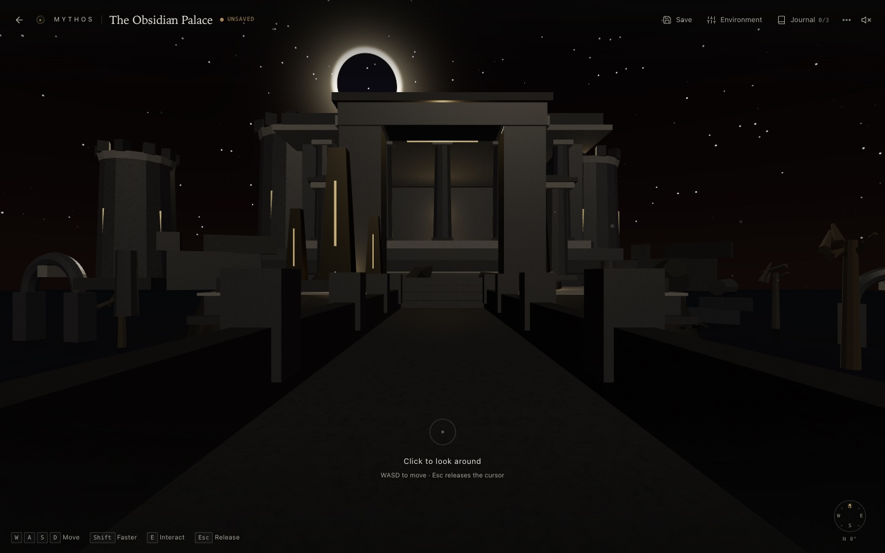
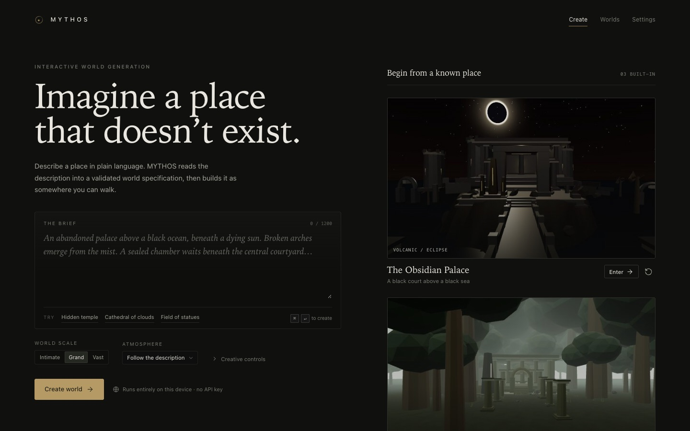
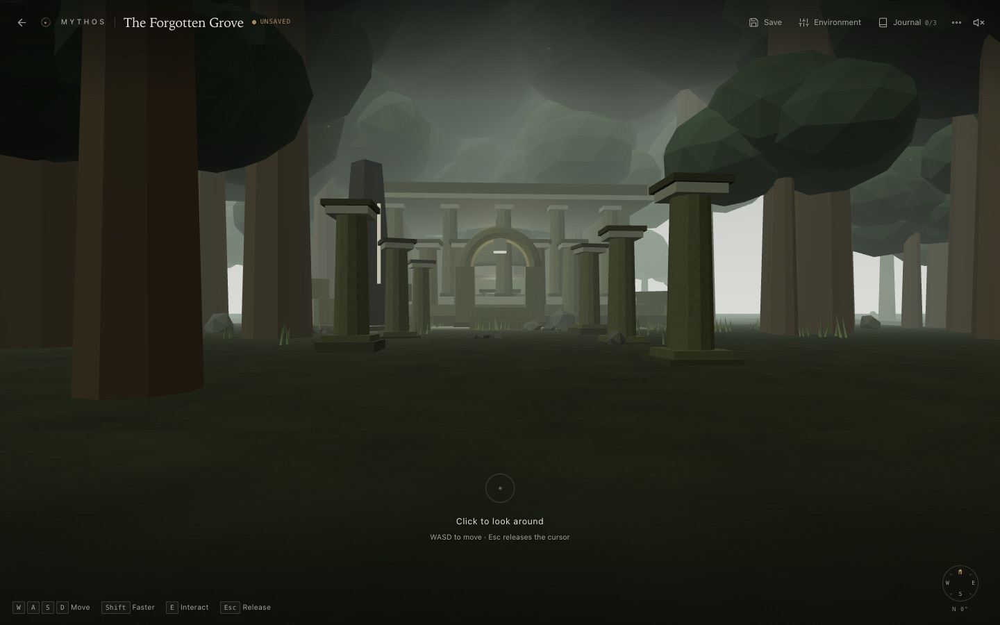
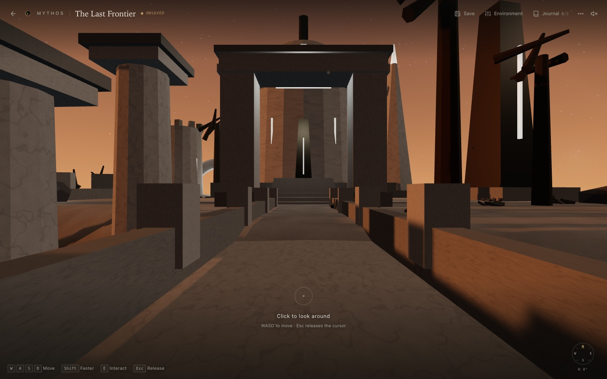
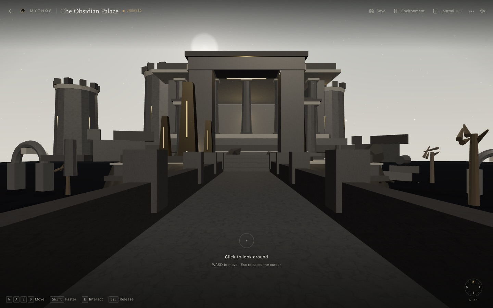
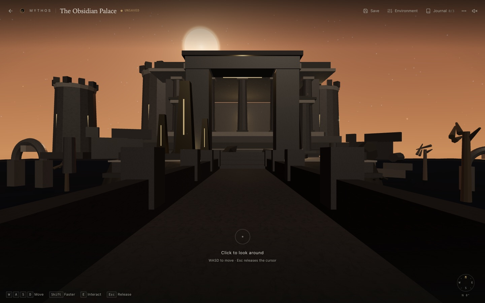
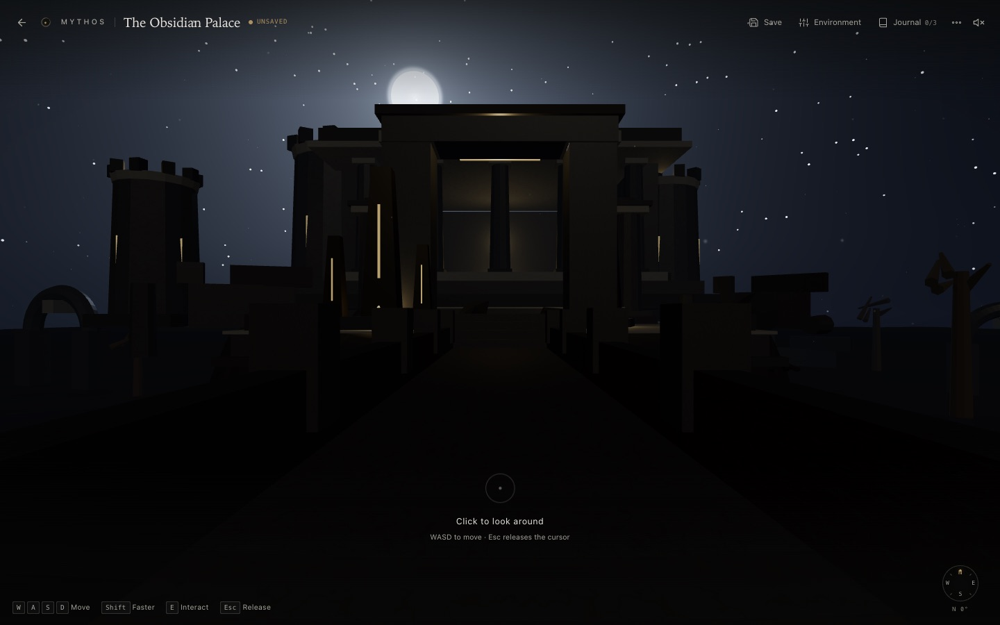
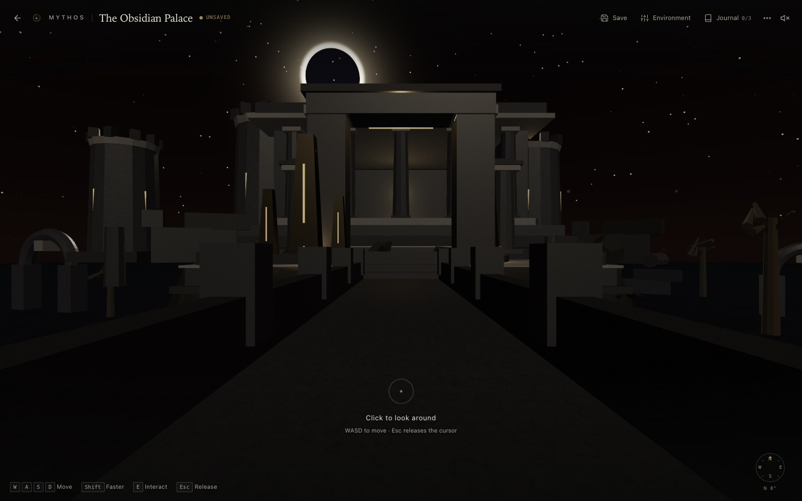
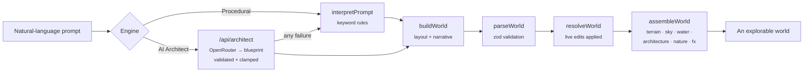

<div align="center">

# M Y T H O S

**Describe a world. Then walk into it.**

An interactive procedural world-generation engine — natural language in,<br>
a fully explorable, atmospheric 3D world out.



</div>

---

MYTHOS turns a sentence into a place. Type *"a sunken obsidian palace beneath an eclipse"* and the engine interprets the prompt, composes a validated declarative world spec, and assembles a real-time 3D world you can explore on foot — with discoveries to find, events to trigger, a live editor to reshape the mood, and a library that remembers everything.

Built for the **Openfire Hackathon**.

## What it does

**Dream it**

- Natural-language prompts compile into a typed, zod-validated world spec — every world is fully serializable
- **AI World Architect (optional)**: an OpenRouter-backed planner turns your description into a structured blueprint — biome, palette, scale, landmarks, discoveries, events — which the same procedural engine then builds. No key? The procedural engine runs everything, unchanged
- Three curated presets to start from: *The Obsidian Palace* (volcanic eclipse), *The Forgotten Grove* (forest mist), *The Last Frontier* (desert observatory)
- Seeded procedural generation — terrain, architecture, vegetation, sky, water, and narrative all derive from the same deterministic seed

**Enter it**

- First-person exploration: pointer-lock look, sprint, jump, gravity, step-up, real collision
- Discoveries with a journal, world events with staged state, procedural ambient audio
- Custom shaders throughout — eclipse corona, sun halo, animated sky, fog-aware water

**Keep it**

- Live editor: time of day, stone tone, fog and water colour, sun position — cheap uniform edits apply in ~0.3 ms, structural edits rebuild only what changed
- Natural-language revision: *"make it colder and foggier"* re-plans the atmosphere through the architect, validates the result, and keeps your discoveries — with one-level undo
- Library persistence in IndexedDB with rendered thumbnails, rename, duplicate, remix
- Export / import worlds as portable `.mythos.json` files

## Around the atelier

<div align="center">



*The atelier — where every world begins as a sentence.*

<table>
  <tr>
    <td></td>
    <td></td>
  </tr>
  <tr>
    <td align="center"><em>The Forgotten Grove</em></td>
    <td align="center"><em>The Last Frontier</em></td>
  </tr>
</table>

**One world, four skies** — the same palace, repainted live from the editor:

<table>
  <tr>
    <td></td>
    <td></td>
    <td></td>
    <td></td>
  </tr>
  <tr>
    <td align="center"><em>Day</em></td>
    <td align="center"><em>Dusk</em></td>
    <td align="center"><em>Night</em></td>
    <td align="center"><em>Eclipse</em></td>
  </tr>
</table>

</div>

## Quick start

```bash
git clone https://github.com/Aryan-Protein-Vala/mythos.git
cd mythos
npm install
npm run dev        # → http://localhost:5173
```

```bash
npm run build      # production bundle in dist/
npm run preview    # serve the production build
npm test           # 21 unit tests (vitest + fake-indexeddb)
npm run typecheck  # strict tsc, zero errors
```

## Controls

| Input | Action |
| --- | --- |
| Click | Capture the mouse / look around |
| `W A S D` / arrows | Move |
| `Shift` | Sprint |
| `Space` | Jump |
| `E` | Interact with discoveries & events |
| `J` | Open the journal |
| `Esc` | Close a panel / release the cursor |
| `⌘/Ctrl + S` | Save the world to the library |

## How a world is made



## AI World Architect

The architect is an **optional planning stage**. The model never touches the renderer and never emits geometry, code, URLs or shaders — it produces a small *blueprint* (biome, palette, atmosphere, scale, landmark prose, discovery text, event text) that is validated, clamped and fed into the exact same `buildWorld` pipeline the keyword interpreter uses.

**Enable it**

```bash
cp .env.example .env.local   # fill in your OpenRouter key
npm run dev                  # the Vite dev middleware serves /api/architect
```

| Variable | Default | Purpose |
| --- | --- | --- |
| `OPENROUTER_API_KEY` | — | Server-side credential. Never in browser code, storage, exports or error payloads |
| `OPENROUTER_MODEL` | `openrouter/free` | Model id routed by OpenRouter |

For production, set the same variables in your Vercel project settings — `api/architect.ts` deploys as a serverless function next to the static app, no extra backend required. On a static-only host the architect simply reports itself unavailable and the AI controls disappear; procedural generation is unaffected.

**Reliability ladder** (at most two model calls per request): structured JSON-schema output → JSON-only retry with validation feedback → honest failure. Rate limits, timeouts, empty and invalid responses all degrade to procedural generation with a visible note. Every world carries a truthful `generation.method` tag — `AI Architect` or `Procedural` — in the world view.

**Honest limits**: the architect plans within the engine's vocabulary. It chooses themes, palettes, scale, atmosphere and the written layer; placement and geometry come from the engine's deterministic building blocks. Revisions are limited to the same parameters the live editor exposes — a request the engine cannot represent (say, a brand-new bridge between two specific towers) is reported in the reply as unsupported, not faked.

The spec is the product: everything the renderer draws comes from one declarative, versioned document (`SCHEMA_VERSION 3`). Edits, exports, saves, and remixes are all transformations of that document.

## Under the hood

```
src/
├── world/       prompt → spec: interpreter, builder, presets, zod schema,
│                seeded RNG, heightfield terrain, resolver
├── engine/      spec → pixels: three.js renderer, custom sky/water shaders,
│                architecture & nature assemblers, particles, controls,
│                AABB collision, thumbnail renderer
├── state/       zustand store — worlds, edits, discoveries, events, toasts
├── storage/     IndexedDB persistence + .mythos.json export/import
├── audio/       procedural filtered-noise ambience
└── ui/          atelier, library, world HUD, editor panel, settings
```

- **Vite 8 · React 19 · TypeScript 7 · three.js 0.186** (raw — no R3F) · **zod 4** · **zustand 5**
- The three.js engine is code-split behind `React.lazy` — the entry chunk stays ~124 kB gzip and the renderer loads on first world entry
- Deterministic seeded generation: same seed, same world, every time
- 21 passing unit tests across world-building and storage layers

## The export format

Every world travels as a single `.mythos.json` envelope — format version, export timestamp, generator, and the complete spec. Import it back and the world is rebuilt byte-for-byte from its seed and document.

```json
{
  "format": "mythos.world",
  "formatVersion": 1,
  "exportedAt": 1793009410662,
  "generator": "MYTHOS",
  "spec": { "...": "the entire declarative world" }
}
```

---

<div align="center">

**MYTHOS** — every world begins as a sentence.

</div>
